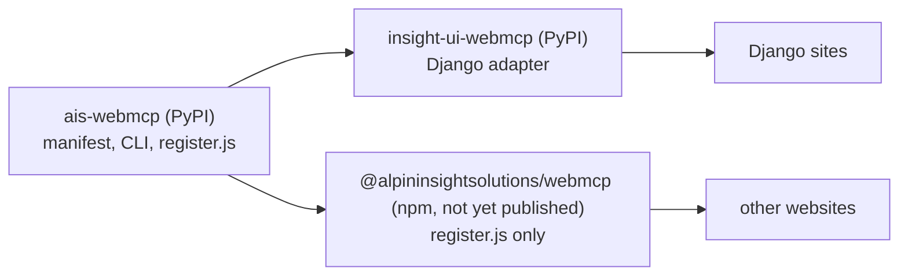

# AIS WebMCP — manage WebMCP for any website

Make your website's capabilities clear to AI agents. `ais-webmcp` is the
framework-independent PyPI command for creating, validating and maintaining
WebMCP descriptions in the context of your website.

Use it with static sites, CMS websites, documentation portals or custom web
applications. Work with local JSON and YAML manifests, then connect the shared
browser helper to your website's own content and actions.

**DE:** Das frameworkunabhängige PyPI-Kommando, mit dem Sie WebMCP-Beschreibungen
für jede Art von Webseite erstellen, prüfen und sinnvoll pflegen können.

Documentation: <https://insight-ui-webmcp.alpininsight.ai/>

## Status

- Early preview: `ais-webmcp` has been published on PyPI since 20.10.2026
  (0.1.x). Interfaces may still change.
- WebMCP is a draft of the
  [W3C Web Machine Learning Community Group](https://www.w3.org/community/webmachinelearning/)
  ([draft specification](https://webmachinelearning.github.io/webmcp/)). It is
  not a W3C Standard and is not on the W3C Standards Track. This package
  targets the `document.modelContext` API only.
- The npm package `@alpininsightsolutions/webmcp` is not yet published.

## Background

[Insight UI](https://pypi.org/project/insight-ui/) is our open-source,
WCAG-focused UI package, which we presented at the September meetup of the
Berlin Python User Group, hosted at our office. Our work on WebMCP grew out
of it as an extension, which is why we built insight-ui-webmcp first. At the
meetup, people asked whether we could offer it without the Django layer we
use for all our production-critical applications. That question is how
ais-webmcp came about: the same WebMCP core, without the framework. We look
forward to hearing what you think, and we warmly welcome contributions; see
how to contribute in the [documentation](https://insight-ui-webmcp.alpininsight.ai/).

## Packages at a glance

One browser runtime, `register.js`, ships in the Python package and, once it
is published, in the npm package.



- `ais-webmcp` on PyPI is the core: manifests, the CLI, and `register.js`.
  The Django adapter `insight-ui-webmcp` installs that core.
- `@alpininsightsolutions/webmcp` on npm will contain `register.js` only, for
  other websites. It is not yet published.

The unscoped npm package `webmcp` is unrelated.

```bash
pip install ais-webmcp
ais-webmcp init --output manifest.yaml --static
ais-webmcp validate manifest.yaml
ais-webmcp list manifest.yaml
ais-webmcp doctor manifest.yaml --html index.html
ais-webmcp export manifest.yaml --output webmcp.manifest.json
ais-webmcp export manifest.yaml --kind tools --output tools.json
ais-webmcp export manifest.yaml --kind snippet --output snippet.html
ais-webmcp diff manifest.yaml webmcp.manifest.json
```

Python 3.12+; Django is not required. `doctor` and `status` report local
configuration and refuse remote URLs; browser support is verified separately.
CSP is noted and not rewritten. Origin Trial tokens are redacted to character
lengths. `export` can write a canonical manifest, a JSON tools list, or a
static snippet with no token. Existing files are protected unless you pass
`--force`. Consequential tools stay disabled in scaffolds until the host
explicitly enables and implements them.

## Output schemas

`outputSchema` is an optional extension by Alpin Insight Solutions, modelled
on MCP `Tool.outputSchema`. It is not part of the WebMCP specification yet:
adding it is an open proposal
([webmachinelearning/webmcp#9](https://github.com/webmachinelearning/webmcp/issues/9),
specification PR
[webmachinelearning/webmcp#254](https://github.com/webmachinelearning/webmcp/pull/254)).
Browsers currently ignore the field; `ais-webmcp` uses it for validation.

Declare a [Draft 2020-12 JSON Schema](https://json-schema.org/draft/2020-12)
for each tool result next to its input schema. The canonical key is
`outputSchema`; `output_schema` is an alias, and only one of them may be set.
`ToolSpec.output_schema` writes `outputSchema`.

`ais-webmcp validate` checks a present output schema: it must be a JSON object
and a valid [Draft 2020-12](https://json-schema.org/draft/2020-12) schema. An
invalid schema fails validation. Omitting the schema does not. The result stays
`ok`, the exit code stays 0, and each tool without a schema adds a finding:

<!-- markdownlint-disable MD013 -->

```json
{
  "path": "tools[0]",
  "code": "missing_output_schema",
  "severity": "low",
  "message": "missing outputSchema (also accepts output_schema). Optional for existing hosts; absence is a low-severity finding."
}
```

<!-- markdownlint-enable MD013 -->

Check engines can treat `missing_output_schema` as a low-severity finding.
Existing hosts keep validating until they declare output schemas. Text reports
print `finding:` lines and still start with `ok:` when there are no errors.

For Django and [Insight UI](https://pypi.org/project/insight-ui/) applications,
add the insight-ui-webmcp adapter. The core owns the shared schema and browser
runtime; the adapter uses the installed core rather than shipping a second
copy.

## npm package (not yet published)

The browser runtime is prepared as the public package
`@alpininsightsolutions/webmcp`. It is not yet published on npm, so
installing it from npm does not work yet. Enterprise code never goes to
npm. The tarball is only the built `register.js`, its types, this README,
`LICENSE`, and `NOTICE` (`package.json` is included because npm always packs
it). A path under `enterprise/`, a path containing `webmcp_check`, or a `.env`
file fails the tarball guard.

|            |                                 |
| ---------- | ------------------------------- |
| PyPI / CLI | `ais-webmcp`                    |
| npm        | `@alpininsightsolutions/webmcp` |
| global     | `InsightUiWebmcp`               |

Intended usage once the package is published:

```ts
import InsightUiWebmcp from "@alpininsightsolutions/webmcp";

const status = InsightUiWebmcp.status();
if (status.supported) {
  await InsightUiWebmcp.registerFromManifest(
    {
      profile: "webpage",
      version: "1",
      tools: [
        {
          id: "search",
          name: "Search",
          description: "Search this page",
          inputSchema: {
            type: "object",
            properties: { q: { type: "string" } },
          },
        },
      ],
    },
    {
      search(input: { q?: string }) {
        return { results: [] };
      },
    },
  );
}
```

A `<script>` tag assigns that same object to `window.InsightUiWebmcp`.

The committed npm version is the `0.0.0` placeholder. Publish stamps the
`vX.Y.Z` tag into `package.json` when the name stays in the
`@alpininsightsolutions` scope, the license is `Apache-2.0`, the files
allowlist includes `LICENSE` and `NOTICE`, and the repository URL is
`git+https://github.com/alpininsight/ais-webmcp.git`. `npm run build:release`
then injects that version into `register.js`. The workflow packs that build
and publishes the tarball with provenance. `prepublishOnly` rejects a local
`npm publish` while the version is still `0.0.0`. Publishing runs from
`.github/workflows/npm-publish.yml`, a manual dispatch from `main` with that
tag. Trusted Publishing attaches provenance. The trusted publisher is bound
to `alpininsight/ais-webmcp`, workflow `npm-publish.yml`, and environment
`npm-ais-webmcp`. A release goes out only with Peter's go. The first publish
is the manual bootstrap.
One-time npmjs.com setup is described in the repository's release notes for maintainers.

## Development

```bash
uv sync --locked --all-groups
npm ci
npm run check:js-build
npm test
uv run --locked pytest
uv run --locked pre-commit run --all-files
```

Python 3.12–3.14 and Node 24 are the versions this repository tests. Node 24
is the repo pin (`.nvmrc` and `devEngines`); the published package does not
set `engines`, so installing the browser runtime does not warn on other Node
versions. Each release contains exactly one wheel and one sdist.

License: Apache-2.0 with NOTICE. Bundled dependencies retain their own licenses
in the generated runtime banner.

## Split provenance

Core history was extracted from insight-ui-webmcp at commit
`d6ead80843dbe42096791dd6688ed58a35dc3291`. The original repository history
and existing host pins are preserved.

## CI and Python release

The repository documents code versus metadata checks, Main CI reuse and the
central build-once Python publication handoff for maintainers.
