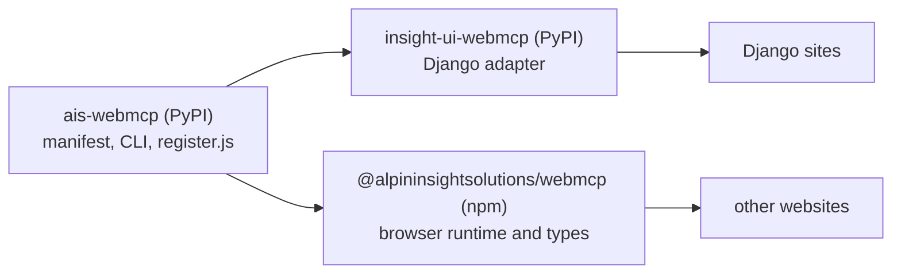

# AIS WebMCP — manage WebMCP for any website

Make your website's capabilities clear to AI agents. `ais-webmcp` is the
framework-independent PyPI command for creating, validating and maintaining
WebMCP descriptions in the context of your website.

Use it with static sites, CMS websites, documentation portals or custom web
applications. Work with local JSON and YAML manifests, then connect the shared
browser helper to your website's own content and actions.

**DE:** Das frameworkunabhängige PyPI-Kommando, mit dem Sie WebMCP-Beschreibungen
für jede Art von Webseite erstellen, prüfen und sinnvoll pflegen können.

Documentation: <https://insight-ui-webmcp.alpininsight.ai/>

## Status

- Early preview: `ais-webmcp` has been published on PyPI since 20.10.2026.
  Interfaces may still change. See [PyPI](https://pypi.org/project/ais-webmcp/)
  for available versions.
- WebMCP is a draft of the
  [W3C Web Machine Learning Community Group](https://www.w3.org/community/webmachinelearning/)
  ([draft specification](https://webmachinelearning.github.io/webmcp/)). It is
  not a W3C Standard and is not on the W3C Standards Track. This package
  targets the `document.modelContext` API only.
- The browser runtime has been published on npm as
  [`@alpininsightsolutions/webmcp`](https://www.npmjs.com/package/@alpininsightsolutions/webmcp)
  since version `0.2.0` (13.11.2026), under the `latest` tag and with
  provenance. npm releases start at `0.2.0`; from `0.2.1` on, PyPI and npm
  releases share the same version number.

## Background

[Insight UI](https://pypi.org/project/insight-ui/) is our open-source,
WCAG-focused UI package, which we presented at the September meetup of the
Berlin Python User Group, hosted at our office. Our work on WebMCP grew out
of it as an extension, which is why we built insight-ui-webmcp first. At the
meetup, people asked whether we could offer it without the Django layer we
use for all our production-critical applications. That question is how
ais-webmcp came about: the same WebMCP core, without the framework. We look
forward to hearing what you think, and we warmly welcome contributions; see
how to contribute in the [documentation](https://insight-ui-webmcp.alpininsight.ai/).

## Packages at a glance

Three distributions serve different needs. The core Python package and npm
runtime releases use the same browser runtime, `register.js`; the Django
adapter uses the installed core instead of shipping another copy.



- `ais-webmcp` on PyPI is the core: manifests, the CLI, and `register.js`.
  The Django adapter `insight-ui-webmcp` installs that core.
- `insight-ui-webmcp` on PyPI is the Django adapter for the core.
- `@alpininsightsolutions/webmcp` on npm provides `register.js` and
  TypeScript declarations for websites without the Python or Django
  integration.

The unscoped npm package `webmcp` is unrelated.

```bash
pip install ais-webmcp
ais-webmcp init --output manifest.yaml --static
ais-webmcp validate manifest.yaml
ais-webmcp list manifest.yaml
ais-webmcp doctor manifest.yaml --html index.html
ais-webmcp export manifest.yaml --output webmcp.manifest.json
ais-webmcp export manifest.yaml --kind tools --output tools.json
ais-webmcp export manifest.yaml --kind snippet --output snippet.html
ais-webmcp diff manifest.yaml webmcp.manifest.json
```

Python 3.12+; Django is not required. `doctor` and `status` report local
configuration and refuse remote URLs; browser support is verified separately.
CSP is noted and not rewritten. Origin Trial tokens are redacted to character
lengths. `export` can write a canonical manifest, a JSON tools list, or a
static snippet with no token. Existing files are protected unless you pass
`--force`. Consequential tools stay disabled in scaffolds until the host
explicitly enables and implements them.

## Output schemas

`outputSchema` is part of the WebMCP draft specification since
[webmachinelearning/webmcp#254](https://github.com/webmachinelearning/webmcp/pull/254)
(merged 2026-11-02, closing
[webmachinelearning/webmcp#9](https://github.com/webmachinelearning/webmcp/issues/9)),
modelled on MCP `Tool.outputSchema`. Chrome 159 and later
(from 159.0.8140.0) accept it on `document.modelContext.registerTool()`.
`register.js` passes that object through unchanged. If registration fails
because the browser reports `outputSchema` as an unexpected or unsupported
member, the helper registers the tool once more without the member so older
browsers still succeed. A failure that says the schema itself is invalid is
not retried. WebIDL dictionaries ignore unknown members, which is how current
older Chrome builds behave.

What the browser should do when a tool result does not match `outputSchema`
is still open in
[webmachinelearning/webmcp#92](https://github.com/webmachinelearning/webmcp/issues/92).
This helper never rejects a result for that reason. For development, pass
`validateOutput: true` to `registerTool` or `registerFromManifest`. A mismatch
writes a `console.warn` and the original result is returned. The same mismatch
for the same tool warns once. The option is off by default, so a production
registration does not warn and does not block.
The check is not a full JSON Schema validator and does not add one to the
page. It covers `type` (including `integer` and a list of types), `required`,
`properties`, `items`, `enum`, `const`, and `additionalProperties: false`.
`additionalProperties: false` warns for any own property that is not in
`properties`, without naming that property. `patternProperties` is not
evaluated, because a schema regular expression can block the page. When it
is present, keys outside `properties` are treated as possibly allowed, so
`additionalProperties: false` is not checked for that object and pattern
subschemas are not applied. `prefixItems`
checks tuple positions, and `items` applies only to elements after that
prefix. Every remaining array element is checked; a warning lists at most
three paths.
`const` and `enum` compare nested objects and arrays up to 8 levels. Past
that the comparison is skipped, so a deep value is not reported as a
mismatch. String `pattern` is not evaluated for the same reason. Warning
text uses schema paths and array indexes only, never a result value or a
key taken from the result. Boolean
subschemas, including `items: false`, are not evaluated. An empty
`prefixItems` array is not a valid Draft 2020-12 schema, so registration
rejects it; omitting `prefixItems` is how a schema declares no tuple
positions. It does not evaluate `$ref`, `allOf`,
`anyOf`, `oneOf`, `format`, numeric ranges, or string length, so a mismatch
that lives only in those keywords stays silent.

Declare a [Draft 2020-12 JSON Schema](https://json-schema.org/draft/2020-12)
for each tool result next to its input schema. The canonical key is
`outputSchema`; `output_schema` is an alias, and only one of them may be set.
`ToolSpec.output_schema` writes `outputSchema`.

`ais-webmcp validate` keeps a missing output schema as a low finding. The
manifest stays `ok` and the exit code stays 0. A structurally invalid schema
is an error: the value is not a JSON object (an array, string, number,
boolean, or null, including a boolean JSON Schema), both `outputSchema` and
`output_schema` are set, or the object is not a valid Draft 2020-12 schema.
An empty object is a valid unconstrained schema, not a missing one. Each tool
without a schema adds a finding:

<!-- markdownlint-disable MD013 -->

```json
{
  "path": "tools[0]",
  "code": "missing_output_schema",
  "severity": "low",
  "message": "missing outputSchema (also accepts output_schema). Optional for existing hosts; absence is a low-severity finding."
}
```

<!-- markdownlint-enable MD013 -->

Check engines can treat `missing_output_schema` as a low-severity finding.
Existing hosts keep validating until they declare output schemas. Text reports
print `finding:` lines and still start with `ok:` when there are no errors.

Tool names, ids, titles, and descriptions that contain invisible or control
characters are invalid, as are empty or whitespace-only descriptions. A tool
description over 750 Unicode code points, a schema description over 500, or a
parameter name over 128 adds a low finding `oversized_schema_field` and stays
valid. Every report notes that missing WebMCP annotations `readOnlyHint`,
`untrustedContentHint`, `consequentialHint`, and `debugging` must not be treated
as safe. These are advisory metadata, not security guarantees. A tool that does not set
`readOnlyHint` also gets a low finding `hints_not_safety_assurances`.
The names follow the [WebMCP ToolAnnotations dictionary](https://webmachinelearning.github.io/webmcp/#dictdef-toolannotations).
`registerTool` is unchanged.

For Django and [Insight UI](https://pypi.org/project/insight-ui/) applications,
add the insight-ui-webmcp adapter. The core owns the shared schema and browser
runtime; the adapter uses the installed core rather than shipping a second
copy.

## npm package

`@alpininsightsolutions/webmcp` contains the built `register.js`, its types,
this README, `LICENSE`, and `NOTICE` (`package.json` is included because npm
always packs it). A tarball guard in CI rejects any other path. The first
runtime release is `0.2.0`, published under npm's `latest` tag with
provenance. From `0.2.1` on, npm and PyPI releases share the same version
number. Earlier npm versions were not runtime releases; use `0.2.0` or later.

An unqualified install selects npm's `latest` tag:

```bash
npm install @alpininsightsolutions/webmcp
```

|            |                                 |
| ---------- | ------------------------------- |
| PyPI / CLI | `ais-webmcp`                    |
| npm        | `@alpininsightsolutions/webmcp` |
| global     | `InsightUiWebmcp`               |

Usage:

```ts
import InsightUiWebmcp from "@alpininsightsolutions/webmcp";

const status = InsightUiWebmcp.status();
if (status.supported) {
  await InsightUiWebmcp.registerFromManifest(
    {
      profile: "webpage",
      version: "1",
      tools: [
        {
          id: "search",
          name: "Search",
          description: "Search this page",
          inputSchema: {
            type: "object",
            properties: { q: { type: "string" } },
          },
        },
      ],
    },
    {
      search(input: { q?: string }) {
        return { results: [] };
      },
    },
  );
}
```

A `<script>` tag assigns that same object to `window.InsightUiWebmcp`.

The repository's npm publication workflow uses GitHub Actions Trusted Publishing
and provenance without a stored npm token. The first-publication and maintainer
process is described in [docs/release.md](https://github.com/alpininsight/ais-webmcp/blob/main/docs/release.md).

## Development

```bash
uv sync --locked --all-groups
npm ci
npm run check:js-build
npm test
uv run --locked pytest
uv run --locked pre-commit run --all-files
```

Python 3.12–3.14 and Node 24 are the versions this repository tests. Node 24
is the repo pin (`.nvmrc` and `devEngines`); the published package does not
set `engines`, so installing the browser runtime does not warn on other Node
versions. Each release contains exactly one wheel and one sdist.

License: Apache-2.0 with NOTICE. Bundled dependencies retain their own licenses
in the generated runtime banner.

## Split provenance

The framework-independent core was split from the Django adapter
insight-ui-webmcp at commit `d6ead80843dbe42096791dd6688ed58a35dc3291`. The
core's history and existing host pins are preserved.

## Contributor CI

Contributor CI checks are described in
[docs/ci-and-release.md](https://github.com/alpininsight/ais-webmcp/blob/main/docs/ci-and-release.md).

## Provider scope and in-page clients

This package provides registration and lifecycle helpers, not an in-page
agent client. No client helpers are planned without a concrete product need.
Where supported, use the browser's native APIs directly, for example:

```js
const context = document.modelContext;
if (context && typeof context.getTools === "function" &&
    typeof context.executeTool === "function") {
  const refresh = async () => {
    const tools = await context.getTools();
    console.log(tools.map(({ name, origin }) => ({ name, origin })));
    return tools;
  };
  context.addEventListener("toolchange", refresh);
  const tools = await refresh();
  const tool = tools.find((item) => item.name === "example_tool" &&
    item.origin === location.origin && item.window === window);
  if (tool) {
    const controller = new AbortController();
    const result = await context.executeTool(tool, {}, { signal: controller.signal });
    console.log(result);
  }
  // When the client is disposed: context.removeEventListener("toolchange", refresh);
}
```

A `RegisteredTool` identifies its owner with `origin` and `window`; keep the
returned object for `executeTool` rather than reconstructing it. The optional
execution signal cancels an invocation. Cancellation cannot undo work already
done by a callback. The draft specifies a serialized string result. Browser
behavior is evolving; [upstream issue 361](https://github.com/webmachinelearning/webmcp/issues/361)
tracks a difference for strings and undefined results. Handle failures and
verify the target browser rather than assuming a particular serialization.
`toolchange` should trigger rediscovery, not an assumption of one event per
registration; [upstream issue 374](https://github.com/webmachinelearning/webmcp/issues/374)
tracks batching.

Cross-origin tool exposure is **not supported by this helper** for this
release: it does not pass `exposedTo` to native registration. The draft's
same-origin default applies to the tools it registers; the helper does not
implement or test browser isolation. Native cross-origin use requires the
embedder's `tools` Permissions Policy delegation, the provider's explicit
`exposedTo` and the client's `fromOrigins` opt-in, subject to the browser's
origin checks. See the [draft security model](https://webmachinelearning.github.io/webmcp/#security-and-privacy-considerations).

## Input schemas and serialization

The WebMCP draft makes `inputSchema` optional. This package's manifest and
registration policy is stricter: each tool requires exactly one object input
schema with `type: "object"`. For a tool taking no arguments, use:

```js
await InsightUiWebmcp.registerTool({
  name: "refresh_page_data",
  description: "Refresh the current page data.",
  inputSchema: { type: "object", properties: {} },
  execute: async () => ({ refreshed: true }),
});
```

The helper validates schemas and forwards the schema object to the browser.
Native registration performs its own serialization and can reject circular
schemas or schema `toJSON` failures. Registration errors are returned as a
failed helper result. The callback wrapper forwards the resolved value as-is,
including strings, undefined and values that native serialization cannot
represent; it does not claim those values are accepted by a browser. Browser
serialization and output validation are separate from the helper's optional
warning-only output check. See the [draft specification](https://webmachinelearning.github.io/webmcp/)
and [upstream validation discussion](https://github.com/webmachinelearning/webmcp/issues/92).
